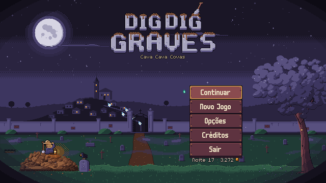
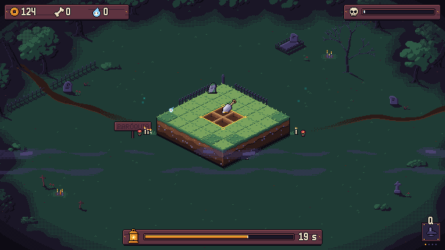

<div align="center">

# ⚰️ Dig Dig Graves

### *Cava Cava Covas*

**Um incremental ativo sobre cavar, crescer e derrubar chefes num cemitério isométrico.**

Pixel art macabra e aconchegante, feito em Godot 4 pela [Briba Studio](https://bribastudio.com).




</div>

## Sobre o jogo

Você é o coveiro do Cemitério da Paróquia. Toda noite tem um **Turno da Noite** cronometrado: passe a área de escavação pelo campo, abra covas, junte cobre e almas, e volte para gastar tudo na **Árvore de Raízes**. Cada raiz nova deixa a pá maior, o campo mais fundo e as noites mais rendosas, até a hora de encarar o chefe.

É um jogo para sessões de 5 a 60 minutos, no nicho de incrementais curtos e satisfatórios como *Nodebuster* e *SuperReap*, com humor e sem sangue.

<div align="center">



</div>

### O que tem no Capítulo 1

- **Turno da Noite:** a área de escavação começa em 1×1 e cresce por lado; o campo começa em 5×5. Cada cova rende mais conforme a profundidade.
- **Árvore de Raízes** com 44 nós no capítulo atual (100 planejados para o v1.0, em 7 ramos), comprados com cobre e almas.
- **Habilidades ativas:** Pisão (golpe em área) e Cava-Funda.
- **Lápides com efeito** que mudam o tabuleiro.
- **Noite do Chefe** contra o Caixão Fujão.
- Tela-título animada com splash da Briba Studio, diálogos com retrato e save automático.
- **Trilha e efeitos 100% sintetizados** em Python (sanfona, cravo, piano de salão), sem samples de terceiros.

### Para onde vai (v1.0)

5 estágios com diorama e chefe próprios, Epitáfios (cartas por noite), o Mascate com pás e amuletos, ajudantes, hub na superfície da Árvore e um final com créditos. O plano completo está no [GDD](docs/01_GDD.md).

## Controles

| Ação | Mouse e teclado |
|---|---|
| Mover a área de escavação | Mouse |
| Pisão | Clique esquerdo ou `Q` |
| Cavar ▶ / Enfrentar o chefe | `Espaço` ou `F` |
| Árvore: mover · ramo · centralizar · ficha | Arrastar e roda · `1`–`7` · `Home` · `Tab` |
| Avançar diálogo | Clique, `Espaço` ou `Enter` |
| Pausar | `Esc` |

Acessibilidade: volume por canal, reduzir flashes, intensidade do tremor, reduzir movimento, tamanho dos números, pausa ao perder o foco e auto-pisão.

## Rodando o projeto

1. Instale o [Godot 4.7](https://godotengine.org/download) (versão padrão, sem .NET). O projeto usa o renderizador **GL Compatibility**.
2. Clone o repositório:
   ```bash
   git clone https://github.com/Pews-DEV/dig-dig-graves.git
   ```
3. Importe o `project.godot` no Godot, ou pela linha de comando:
   ```bash
   godot --headless --path . --import
   ```
4. Aperte **F5** para jogar.

## Testes e simulação

Os testes rodam sem janela:

```bash
godot --headless --path . -s res://tests/<arquivo>.gd
```

Os `sim_*.gd` jogam a campanha inteira em simulação para calibrar o ritmo. Todos os números de balanceamento ficam em `data/balance.tres` e nos `.tres` de `data/`.

## Estrutura

```
autoload/     jogo, economia, save, áudio, eventos e configurações
scenes/
  title/      tela-título animada, logo e créditos
  run/        o Turno da Noite: campo isométrico, covas, HUD e chefe
  tree/       a Árvore de Raízes
  hub/        superfície da Árvore
  ui/         telas e componentes de interface
data/         balanceamento, estágios, chefes, nós da árvore e diálogos (.tres)
assets/       sprites, tiles, fontes, música e efeitos
art_src/      arquivos-fonte do Aseprite
audio_src/    síntese da trilha e dos efeitos (Python: numpy/scipy)
localization/ textos (pt-BR)
tests/        testes e simulações da campanha
docs/         GDD, direção de arte, UI/UX, história e roadmap
```

### Documentação

| Documento | Conteúdo |
|---|---|
| [01_GDD.md](docs/01_GDD.md) | Regras, números, arquitetura e marcos |
| [02_DIRECAO_DE_ARTE.md](docs/02_DIRECAO_DE_ARTE.md) | Estilo visual e paleta Lua de Cova 32 |
| [03_UI_UX.md](docs/03_UI_UX.md) | Interface, animação e som |
| [07_HISTORIA.md](docs/07_HISTORIA.md) | Tratamento narrativo |
| [06_PLANO_V1.md](docs/06_PLANO_V1.md) | Plano de produção do v1.0 |

## Contribuindo

Issues e pull requests são bem-vindos. Antes de mudar regra ou número, dê uma olhada no [GDD](docs/01_GDD.md); para visual, na [direção de arte](docs/02_DIRECAO_DE_ARTE.md). Mudanças grandes: abra uma issue antes para a gente conversar.

## Licença

- **Código** (`.gd`, `.py`, cenas e ferramentas): [MIT](LICENSE).
- **Arte, áudio, nome e marca** (sprites, tiles, música, efeitos, logo): [CC BY-NC 4.0](LICENSE-ASSETS.md). Pode estudar, remixar e usar em projetos não comerciais, com crédito. Para uso comercial, fale com a gente.
- **Fontes m5x7, m6x11 e m6x11plus**, de Daniel Linssen: licenças próprias, ver [CREDITS.md](CREDITS.md).
- Feito com [Godot Engine](https://godotengine.org) (MIT).

<div align="center">

Feito no Ceará pela **[Briba Studio](https://bribastudio.com)** 🦎

</div>
